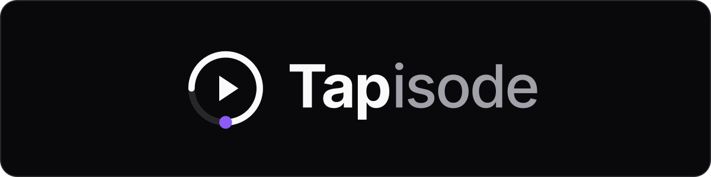
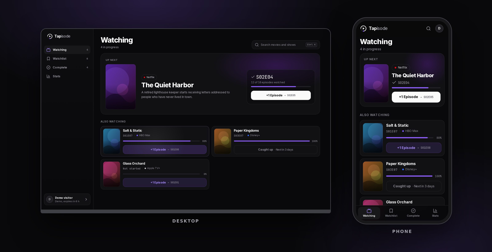

# Tapisode: movies & shows tracker

<div align="center">
  
</div>

<br>

<div align="center">
  
  
  
  
  
  
  
  
  
</div>

---

<div align="center">
  
</div>

---

**Tapisode** is a fast, phone-first minimalist tracker for movies and TV shows.
Keep tabs on what you are watching without social feeds, ratings, or unnecessary
noise.

Tap `+1 Episode` directly on your active shows to advance your progress
instantly. Check where a title is currently streaming (Netflix, HBO Max,
Disney+, Prime Video, and others) in your country without juggling multiple
guides.

Dark by default, built phone-first, installable as an app, and fully responsive
on desktop.

## 📖 Table of contents

- [✨ What it does](#-what-it-does)
- [🧱 Stack](#-stack)
- [🔧 How it's built](#-how-its-built)
- [🚀 Run it locally](#-run-it-locally)
- [☁️ Run it on a host](#️-run-it-on-a-host)
- [⚠️ Limitations](#️-limitations)
- [📚 Documentation](#-documentation)
- [🎬 Data and attribution](#-data-and-attribution)

## ✨ What it does

1. **One-tap episode progress.** Advance active shows with a thumb-friendly `+1 Episode`
   button. The change shows at once and can be undone.
2. **Three states, nothing else.** Watching, Watchlist, Complete. No ratings, no
   feeds, no recommendations. The rules keep the state and the episode in step: a
   show still airing never counts as complete.
3. **Where it streams.** See which of your services carry a title in your country,
   and filter your lists by service.
4. **Title drawer.** Tap any title for a bottom sheet (a dialog on desktop) with the
   synopsis, your progress, an episode picker and streaming availability.
5. **Search and stats.** Press `Ctrl K` or `⌘K` to search, and see your episode count,
   hours and a shareable stats image.
6. **Try it without an account.** A demo session starts with a ready-made list and
   lasts six hours. Creating an account keeps the list.
7. **Installable.** A web app manifest, icons and an offline page make it installable
   on a phone.

## 🧱 Stack

| Layer | Technology |
| :--- | :--- |
| Frontend | Next.js 16 (App Router), React 19, Tailwind CSS 4, shadcn/ui (Radix, Vaul, cmdk) |
| Backend | Next.js Server Actions and Route Handlers |
| Database | PostgreSQL 17 (Neon with connection pooling) |
| ORM | Drizzle ORM |
| Auth | Better Auth (email and password, anonymous demo sessions) |
| Validation | Zod |
| Testing | Vitest and fast-check, Playwright, axe, Lighthouse CI |
| External APIs | TMDB behind a replaceable provider port |
| Dev environment | Dev Container (VS Code) |

## 🔧 How it's built

Not a feature list. Each line is an architectural principle you can verify in
the codebase.

| Claim | Proof |
| :--- | :--- |
| **Provider-agnostic domain (hexagonal architecture)** | The rules are pure functions that import nothing outside the domain. The catalog is reached through the `MediaProvider` port, implemented by `TmdbProvider` and `FakeProvider`, and one file chooses between them. [src/domain/](src/domain/), [src/lib/providers/](src/lib/providers/) |
| **Layers enforced by lint** | `domain`, `config`, `db`, `lib`, `actions`, `api` and `ui` may only import downward. A violation fails `npm run lint` in CI. [eslint.config.mjs](eslint.config.mjs) |
| **Every action authorizes itself** | Server Actions verify the session, validate input with Zod, and ensure user ownership before any mutation. [src/actions/](src/actions/) |
| **One rule for every change, no lost updates** | A single `transition` function decides each change, and each write is a compare-and-set against the state the user saw, so two devices or a double tap cannot overwrite each other. Property tests cover it. [src/domain/transitions.ts](src/domain/transitions.ts), [tests/domain/](tests/domain/) |
| **Fast optimistic progress updates** | The library store applies the same domain function to preview a change, sends it with the state it saw, and rolls the preview back on failure (`useOptimistic`). [src/components/library/](src/components/library/) |
| **Vendor-neutral data model** | A title is `provider`, `media_type` and `external_id`, with an optional `imdb_id` bridge. TMDB content lives in a separate cache table that can be emptied without touching a list. [src/db/schema/](src/db/schema/) |
| **Rate limits without extra infrastructure** | Counters and a circuit breaker live in Postgres, so the same code runs on Vercel and in a container. [src/lib/limits/](src/lib/limits/) |
| **Mobile-first, desktop-ready** | Bottom navigation and thumb-friendly drawers on phones; a sidebar, a dialog and a multi-column grid on desktop. [src/components/](src/components/) |
| **Accessible and fast, checked in CI** | axe finds no violations on any screen, tap targets are at least 44px on a phone, and Lighthouse scores stay above 0.9. [e2e/](e2e/), [lighthouserc.json](lighthouserc.json) |

## 🚀 Run it locally

Everything runs inside the dev container; nothing needs to be installed on your
host machine.

1. **Create the environment file.** It is gitignored:

   ```bash
   cp .env.example .env
   ```

   Fill in `BETTER_AUTH_SECRET` (`openssl rand -base64 32`) and
   `TMDB_API_READ_ACCESS_TOKEN`. To try the app without a TMDB token, set
   `MEDIA_PROVIDER=fake` instead: it uses invented titles.

2. **Open the repository in the container.** In VS Code, run *Dev Containers: Reopen in
   Container*. On every start the container brings PostgreSQL up, applies the
   migrations, and seeds the sandbox template and a dev account the first time.

3. **Start the development server:**

   ```bash
   npm run dev
   ```

   Open [http://localhost:3000](http://localhost:3000). Sign in with the dev account
   `dev@tapisode.test` and the password `tapisode-dev`, or choose "Try without an
   account".

Outside the container the same steps are `npm install`, `npm run db:migrate` and
`npm run db:seed`. The checks are `npm run lint`, `npm test` and `npm run test:e2e`, and
[docs/dev-environment.md](docs/dev-environment.md) explains them.

## ☁️ Run it on a host

The same application and code. Only environment variables differ.

1. **Database:** Create a PostgreSQL 17 database (such as Neon with pooling).
2. **Deploy:** Import the repository into Vercel, or run it in any container runtime.
3. **Set environment variables:**

   | Variable | Description |
   | :--- | :--- |
   | `DATABASE_URL` | Pooled PostgreSQL connection string for queries |
   | `DATABASE_URL_UNPOOLED` | Direct connection string for Drizzle migrations |
   | `BETTER_AUTH_SECRET` | Secret key for auth tokens (`openssl rand -base64 32`) |
   | `BETTER_AUTH_URL` | Public production URL of the app |
   | `TMDB_API_READ_ACCESS_TOKEN` | TMDB API Read Access Token (bearer token) |
   | `CRON_SECRET` | Protects the cron route (`openssl rand -base64 32`) |
   | `NEXT_SERVER_ACTIONS_ENCRYPTION_KEY` | Encrypts Server Action ids when more than one instance serves traffic |
   | `MEDIA_PROVIDER` | Optional: `tmdb` (default) or `fake` |

4. **Migrations:** The build command in [vercel.json](vercel.json) runs the migrations
   and creates the sandbox template, but only on production builds
   (`VERCEL_ENV=production`, which is a push to `main`). Updating the app is a push
   to `main`.
   Preview deployments do not migrate. Point them at their own Neon branch, and migrate
   that branch by hand with `DATABASE_URL_UNPOOLED=<branch> npm run db:migrate` when a
   pull request changes the schema.
5. **Weekly job:** `vercel.json` also schedules `/api/cron/maintenance`, which refreshes
   tracked titles, purges old catalog content and deletes expired demo sessions.

## ⚠️ Limitations

What is known, and what has not been proven yet:

- **The app was exercised on the fake provider.** The TMDB adapter was also checked once against the live API (search, a series,
  a movie and the region list), but the whole app has not been clicked through on live TMDB data.
- **Nothing was run on a live host.** The client IP and country headers, the weekly cron on Vercel, the sign-in limiter behind
  Vercel's proxy and the Neon pooler with prepared statements off are described and unit tested, but untested in production.
- **Nothing was run on a real phone.** Installing the app, the home screen launch, the vibration on `+1` and anything iOS-specific
  need the checklist in [docs/dev-environment.md](docs/dev-environment.md).
- **A title leaves a list only by undoing its add or by deleting the account.** There is no remove button.
- **Rewatching is out of scope**, and search results do not show streaming services (the search endpoint does not carry them).
- **No password reset and no email verification** in this version. Use a throwaway email.
- **The demo is shared.** At most 100 demo sessions live at once and one address can start five an hour, so a busy hour or a shared
  network can be turned away with a message.
- **The privacy policy and the terms are plain-language summaries,** not legal advice. Have a qualified person read them before real
  users rely on them.
- **The TMDB mark is a small text tile,** not the official logo. Add the official logo as TMDB's guidelines ask if you publish this.

## 📚 Documentation

Anything that is not in this file lives in [`docs/`](docs/):

- [Dev environment](docs/dev-environment.md): the container, the checks, end-to-end tests, the installable app and the
  checklist before release.
- [Repo layout](docs/repo-layout.md): what every entry in the repository is for.
- [Data model](docs/data-model.md): the tables and what the database enforces.
- [Catalog data](docs/catalog-data.md): the TMDB rules we obey, the six-month purge and the kill switch.
- [Extending](docs/extending.md): how to add a provider or a feature.

## 🎬 Data and attribution


This product uses the TMDB API but is not endorsed or certified by TMDB. Streaming
availability data by JustWatch. Every screenshot in this repository was taken on invented
demo data, never on TMDB content.
